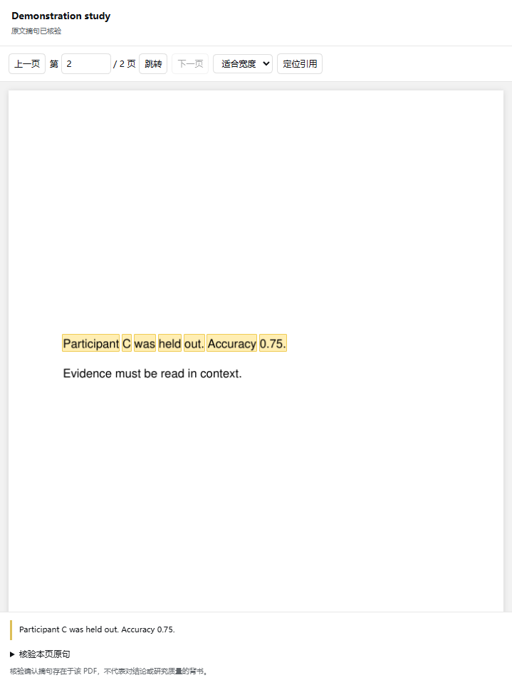

# DSH 文献库

[](https://github.com/Lx23918/dsh-literature/actions/workflows/ci.yml)

在 [DeepSeek Harness](https://github.com/deepseek-ai/deepseek-harness) 中管理、检索和阅读本地论文。复用 DSH 已有的模型、原生流式会话及 PDF 预览，将回答中的核验引用直接定位到论文原句。

日常使用只需要 DSH，无需另行运行 Zotero 或模型 API 代理。插件界面及本说明均为中文。

## 功能

| 场景 | 已实现 |
| --- | --- |
| 建立文库 | 复制 PDF 入库、按文件夹层级导入、按内容哈希去重。 |
| 补全文献信息 | 从 PDF 提取信息；可选通过 Crossref、arXiv 匹配标题、作者、年份、DOI 和摘要。 |
| 查找原文依据 | 本地 SQLite FTS5 关键词检索、PDF 物理页码、词级文字坐标。 |
| AI 阅读 | 以选中文献为范围创建原生研究会话，使用 DSH 已配置的模型、流式回复和历史记录。 |
| 核验引用 | 匹配本地 PDF 原句、记录内容指纹、点击跳页并高亮；PDF 改变后要求重新核验。 |
| 论文写作 | 固定/编辑引用键、BibTeX/BibLaTeX/CSL JSON 导出、LaTeX/Pandoc 快速复制、自动更新 `.bib`。 |
| 整理资料 | 嵌套分类、标签、期刊标记、笔记、可恢复回收站，以及可选 easyScholar 期刊指标。 |

摘句核验确认的是“这句话存在于这份 PDF”。它是否支持某个结论，仍需阅读限定条件和上下文。

<details>
<summary>原文定位演示（合成文献）</summary>



演示使用生成的测试文献，没有私人账号、真实论文或模型请求。
</details>

## 环境要求

- **DSH 0.2.1-rc.2**：当前版本的开发与验证基线，其他宿主版本不在该兼容性声明范围内。
- **Node.js 24.13 或更新版本**：通常由 DSH 自带。
- **Python 3.10+**，并安装 `requirements.txt` 中的 PDF 依赖：

  ```sh
  python -m pip install -r requirements.txt
  ```

如果系统命令是 `python3`，请将上面的 `python` 换成 `python3`。解释器须能被启动 DSH 的进程找到；不在其 PATH 中时，见下方配置。

## 安装发布包

先为 DSH 使用的 Python 安装 PDF 依赖，再安装已检查的发布包：

```sh
python -m pip install "PyMuPDF==1.26.5"
dsh plugin --profile desktop add https://github.com/Lx23918/dsh-literature/releases/download/v0.4.0/dsh-literature-0.4.0.tgz
```

安装后重启 DSH；如果使用其他 profile，将 `desktop` 换成对应名称。

## 从源码安装

```sh
git clone https://github.com/Lx23918/dsh-literature.git
cd dsh-literature
python -m pip install -r requirements.txt
npm ci
npm run build
dsh plugin --profile desktop add .
```

如果你使用其他 profile，将 `desktop` 换成对应名称。安装后重启 DSH，左侧出现 **文献库**。源码目录会作为插件安装位置，请保留该目录。

打包文件见 [GitHub Releases](https://github.com/Lx23918/dsh-literature/releases)。插件不提供独立的模型订阅服务，安装也不会自动登录模型账号。

### 配置 Python

优先使用环境变量 `DSH_LITERATURE_PYTHON`；未设置时，Windows 默认用 `python`，其他系统默认用 `python3`。也可以在所用 profile 的 `cordis.patch.yml` 中配置：

```yaml
- id: literature-library-service
  config:
    python: python3
```

必要时填写解释器完整路径，并保留该条目已有的其他配置。环境变量需要对 DSH 的启动进程生效，仅在另一个终端窗口设置不会影响已经运行的桌面端。

## 开始使用

1. 打开 **文献库**，点击 **导入 PDF** 或 **导入文件夹**。
2. 选中文献，点击 **索引所选**，在本地建立文字和坐标索引；这一步不调用模型。
3. 点击 **与所选文献对话**，选择 DSH 已配置的模型并提问。
4. 询问依据时，要求列出论文、原文摘句、PDF 物理页码及核验引用；点击引用可在右侧 **原文定位** 页签查看高亮。

示例提问：

> 请比较所选论文对这个结论的支持程度。逐项给出论文、相关原句和 PDF 物理页码，调用摘句核验工具后再给出可定位引用。

模型需要实际调用文献工具。只有文字回答、没有核验引用的内容，不代表已经通过原文核验。

### 引用与文件夹导入

- **引用与导出**：有勾选时导出所选文献，否则导出当前列表。导出或复制后固定引用键，补全元数据时不再自动改变；可在 **编辑属性** 中自行修改。
- **自动更新 `.bib`**：按整个文库或当前分类及子分类生成，写入文库内 `exports/`。停止自动更新会保留文件。
- **导入文件夹**：一次性递归导入 PDF，目录成为分类；同内容文件复用已有文献并补充分类，原文件不移动。不监听源文件夹后续变化。
- 当前限制：单 PDF 50 MiB、单 PDF 索引 5,000 页、每批文件夹导入最多 10,000 份 PDF；非 PDF 文件跳过。

## 存储与隐私

PDF **复制入库，不采用软链接**。文库包含 `library.sqlite`、`pdfs/`、笔记/索引及可选 `exports/`。首次默认位置为 `$DSH_HOME/literature-library`，之后由实际 profile 中的指针固定目录，避免启动方式改变导致文库位置变化。

在 **数据源与存储 → 文库目录 → 迁移并切换** 修改位置。程序复制数据、校验 PDF 哈希和数据库完整性后切换，旧目录保留为恢复副本。备份应包含完整文库，建议先关闭 DSH。

| 操作 | 会向外发送什么 |
| --- | --- |
| 导入、索引、摘句匹配、页面渲染、参考文献导出 | 这些操作均在本地完成。 |
| AI 阅读 | 工具返回的元数据和原文片段进入你在 DSH 中选择的模型/提供方的上下文。 |
| Crossref、arXiv（启用后） | 用于匹配的标题、标识符；不上传 PDF 二进制或全文。 |
| easyScholar（启用后） | 期刊名和你填写的密钥，发送至其 HTTPS API。 |

外部元数据及期刊服务默认关闭，按需在设置中启用。easyScholar 密钥通过设置表单保存到 DSH 原生凭据库，已保存密钥不回显到客户端；本仓库不含任何密钥。

插件追加独立 `literature` 预设，六个研究工具只在该模式可见，执行时再次检查本会话选中文献范围。不会替换默认模型、全局提示词、普通聊天界面或其他插件设置。

## 当前边界

- 目前是关键词检索，没有向量/语义检索。
- 尚无 OCR、Word 引用集成、CSL 参考文献排版、浏览器 Connector 和云同步。
- 原文定位按需渲染当前 PDF 页并叠加坐标高亮，不修改 PDF；DSH 原生 PDF 预览继续保留。
- 复杂排版可能导致提取顺序不理想，判断结论时请核对上下文。
- 已实现常用引用键、参考文献导出和文件夹导入流程，不等同于完整 Better BibTeX 或 Zotero。
- 模型访问资格、订阅额度及提供方可用性由 DSH 和所选提供方管理。

## 开发与检查

```sh
python -m pip install -r requirements.txt
npm ci
npm run check
npm run check:package
```

构建脚本把 `assets/client-features.js` 和 `assets/library.css` 内联进原生 ModuleLoader 客户端。仓库保留运行代码及对应构建源码。测试使用合成 PDF 和模拟元数据接口，不使用私人论文、账号或付费模型请求；CI 覆盖 Linux 和 Windows。

暂存后运行 `npm run check:staged`，它扫描的是暂存区实际内容，而非仅检查工作文件。`check:package` 检查打包白名单并扫描发布文件；人工复查同样必要。

另见[架构说明](docs/architecture.md)、[贡献指南](CONTRIBUTING.md)、[发布说明](docs/publishing.md)和[安全说明](SECURITY.md)。

## 许可与致谢

Copyright © 2026 Lx23918 and contributors。项目采用 **AGPL-3.0-or-later**，按许可提供且不作担保。允许依规商用，没有额外“禁止商用”限制；见 [LICENSE](LICENSE) 和 [NOTICE](NOTICE)。

PyMuPDF 单独安装，保留其上游 AGPL／商业许可。本仓库及插件包不捆绑 PyMuPDF/MuPDF 二进制，`NOTICE` 提供上游源码和许可入口。

基于 DSH 插件及槽位 API 开发。流程参考 [Better BibTeX](https://retorque.re/zotero-better-bibtex/) 和 [Folder Import for Zotero](https://github.com/retorquere/zotero-folder-import)。本项目独立维护，不是 DeepSeek 或 Zotero 官方插件。
