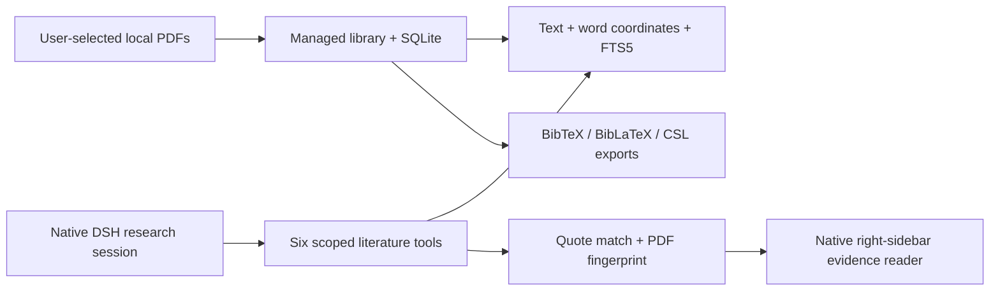

# Architecture

## Host and client

`cordis.patch.yml` adds a library service and a separate `literature` preset. `lib/index.js` exposes the plugin's own typed RPC dispatcher; `lib/research.js` registers tools only in that preset. Ordinary chat does not acquire those tools or their prompt.

`lib/client.js` is a native DSH ModuleLoader bundle using React slots and host theme tokens. It uses DSH's existing sessions, model picker and streaming renderer. The evidence reader is a separate right-sidebar tab; default PDF preview remains available. API changes in other host versions require a compatibility review.

## Evidence

`pdf_extract.py` extracts words with UTF-16 text offsets and normalized display coordinates, including page rotation. `pages` stores the text, `pages_fts` its keyword index, and `page_geometry` the coordinates. `pdf_indexes` records the content fingerprint and extraction version.

`literature_verify_quote` checks session membership, normalizes typographic whitespace/compatibility glyphs and matches source text. It rejects unknown quotes and disambiguates repeated occurrences. A persistent citation stores the quote, source offsets, boxes and PDF hash.

Native chat Markdown accepts full local HTTP links; the client intercepts the plugin's citation marker and resolves the opaque citation ID locally. Historical loopback ports are supported. The host checks scope and content hash again before rendering. Current-page images are generated on demand and are not stored as an image cache.

## Storage and credentials

Each library has its own SQLite database and managed PDF directory. The physical profile stores a separate location pointer. Migration snapshots SQLite, copies/checks PDFs, rewrites managed attachment paths and switches the pointer only after validation. Old data stays available for recovery. Citation records and auto-export configuration move with it.

Optional journal credentials are saved through DSH's credential service. They do not belong in library records, repository files or diagnostic output. Metadata providers receive only the documented lookup fields. Model providers receive the tool output requested in the selected-paper session.

All asynchronous work and registrations have an unload path. Indexing/rendering subprocesses are stopped before database closure; automatic bibliography writes finish before disposal.
